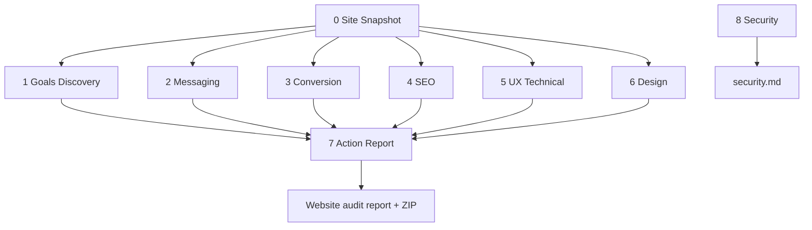
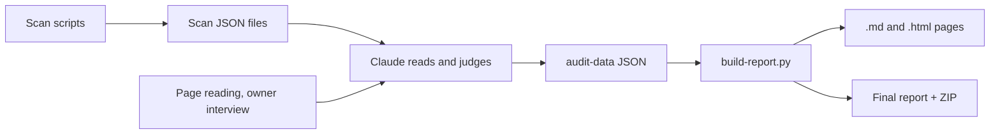
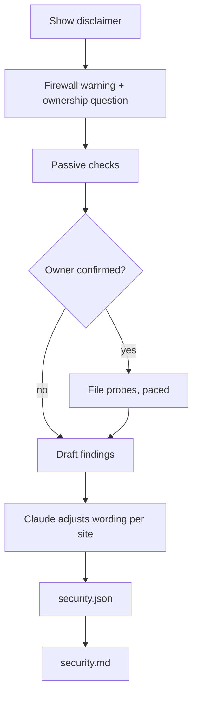

# Website Audit Suite

**Version 1.1.0** · by [Ananas Agency](https://ananas-agency.com)

Website Audit Suite is a Claude Code plugin with nine skills. You give it a website address. It reads the
site, asks you what you want the site to achieve, and delivers a graded action report: a letter grade for
each area and every finding sorted into a do-this-first plan. A separate security check runs on its own. It
is for marketers, site owners and developers who want a clear list of what to fix, in plain words.

It is free and open source ([MIT](LICENSE)). It needs no API keys and no paid service. The one outside
download during a scan is the open-source axe-core accessibility library, which the accessibility scan loads
from a public CDN (a content delivery network). Without it, that part of the scan is skipped and marked. The
security check looks up the site's public email records through the public DNS resolvers 1.1.1.1 and
8.8.8.8.

## The nine skills

Steps 0 to 7 are the audit pipeline. Step 8 runs on its own.

| Step | Skill | What it answers | What it writes |
|---|---|---|---|
| 0 | **Site Snapshot** | What is this site, who is it for, what is its main goal, and which pages matter? | `site-snapshot.json`, `audit.json` |
| 1 | **Goals Discovery** | What does the owner want the site to achieve, and where does that differ from what the site shows? A short interview. | `goals.json` |
| 2 | **Messaging Clarity** | Does a visitor instantly understand what the site offers and why to choose it? | `messaging.json` |
| 3 | **Conversion CRO** | Does the site lead visitors to the main goal, or lose them on the way? | `conversion.json` |
| 4 | **SEO Content** | Can search engines find and understand the pages, and is the content good enough? | `seo.json` |
| 5 | **UX Technical** | Is it easy to use, fast, accessible and sound on a phone? | `ux-technical.json` |
| 6 | **Design Visual** | Does the design look modern and professional, and is it consistent? | `design.json` |
| 7 | **Action Report** | What is the overall grade, and what should be fixed first? | `action-report.json`, the final report and a ZIP |
| 8 | **Security** | What can anyone see from outside that puts the site at risk? | `security.json`, `security.md` |

The report builder turns the JSON of steps 0 to 7 into a `.md` page and a styled `.html` page. Every
finding is written as **Issue, Impact, Fix**, with an impact and an effort rating from 1 to 5. Impact and
effort place it in one of four groups: Quick Win, Big Bet, Fill-in or Skip. Each area also gets a 0 to 100
score and a letter grade. The checks are graded against [benchmarks-2026.md](benchmarks-2026.md), which
lists what a website should meet in 2026. The shared method is in [report-format.md](report-format.md).

### How the steps fit together

Site Snapshot runs first; every other audit step builds on it. Goals Discovery is the owner interview: run
it early, because the Action Report grades every finding against the owner's goal. Steps 2 to 6 are
independent: run one, some or all. Action Report pulls together whatever you ran. Security needs no other
step.



Security is its own path for now. `build-report.py` does not read `security.json`, so the security result
is not part of the Action Report's scorecard or the ZIP. You get it as `security.md` in the run folder.

### Never write the audit without asking the owner first

Every grade is judged against a goal the owner stated. A grade given against a goal nobody stated is a
guess.

- Goals Discovery asks the owner directly. It never invents an answer from the page: anything unknown
  stays **TBD**.
- The Action Report checks for the owner's answers before it builds anything. If Goals Discovery never ran,
  it stops and runs the interview first, even when the request sounded fully automatic ("audit
  mysite.com").
- Only if the owner is genuinely unavailable (a scheduled run, for example) does it go on. The executive
  summary then says the audit is ungrounded.

## Basic and Extended layers

Both layers are free. The only difference is a one-time setup that unlocks measured evidence.

- **Basic.** Claude reads the site and reasons about it. This gives the full graded audit. It needs only
  Python 3.9 or newer, for the report builder.
- **Extended.** Adds checks that need the page to be rendered and timed in a real browser: Core Web Vitals,
  a WCAG accessibility scan, measured mobile fit and tap targets, design tokens with screenshots, and
  tracking and consent behaviour. It needs Python 3.9+, [Playwright](https://playwright.dev/python/) and its
  Chromium browser.

`scripts/setup-check.py` decides which layer you get and prints it as the last line, `MODE:`.

| `MODE:` | When |
|---|---|
| `extended` | Python is 3.9 or newer, Playwright is installed, and Chromium starts. |
| `basic` | Python is fine, but Playwright or Chromium is missing. The script prints the commands that would fix it. |
| `unsupported` | Python is older than 3.9. |

If Python is missing altogether, the script cannot run and there is no `MODE:` line. The first skill you
run does this check and offers to install what is missing.

In a Basic report, checks that need a browser are labelled "not measured". In an Extended report,
findings backed by a scan carry a small `measured` tag. What only the owner's own analytics can show
(conversion rate, traffic, rankings) is taken from the interview or left out. It is never invented.

| Area | Basic | Extended adds |
|---|---|---|
| Site Snapshot, Goals Discovery | Full | Nothing. |
| Messaging | Full, including cross-page. | Nothing required. |
| Conversion | Findings, CTA and link check, is analytics installed. | Consent and cookie behaviour, runtime tracking proof. |
| SEO | Claude reads the key pages. | A site-wide sweep (`seo-sweep.py` needs no browser, so Basic can run it too). |
| UX and Technical | Viewport, HTTPS, markup accessibility, navigation, speed risk flags. | Core Web Vitals, axe accessibility scan, measured mobile fit and tap targets. |
| Design | Declared colours and fonts. | Measured design tokens, desktop and mobile screenshots, cross-page consistency. |
| Action Report | Full synthesis and scorecard. | Same, with measured findings included. |
| Security | Full. | Same. This step makes no use of the browser. |

## Who does what

Scripts measure. Claude reads, judges and writes. The builder checks, scores and assembles. Claude never
writes HTML. The one script that drafts findings is the security scan, and Claude reviews every draft.



The scan scripts are in `scripts/`:

| Script | Measures |
|---|---|
| `setup-check.py` | Whether this machine can run the browser scans. |
| `mobile-audit.py` | Fit to screen, tap targets and text size at phone widths. |
| `perf-a11y-scan.py` | Lab Core Web Vitals, page weight, HTTPS and security headers, and axe-core accessibility. |
| `design-scan.py` | Colour palette, fonts, button styles, desktop and mobile screenshots. |
| `seo-sweep.py` | Titles, meta, headings, canonical and schema across pages. No browser. |
| `tracking-scan.py` | Analytics, pixels, consent layer and whether trackers fire before consent. |
| `interaction-scan.py` | Whether calls to action lead somewhere, how forms validate, and the status of up to 40 links. It never submits a form. |
| `security-scan.py` | The security checks described below. |

Claude writes its results once per skill, as JSON in `audit-<slug>/audit-data/`.
[audit-data-format.md](audit-data-format.md) describes every field. `build-report.py` checks the JSON. It
refuses to build when a field is missing or unknown, when a `[[key]]` reference points nowhere, when the
rubric weights don't add up to 100, or when a finding is marked `measured` without a scan behind it. It
prints what to fix. Then it writes the pages. With `--final` it also writes the consolidated report and a
ZIP.

## The Security step

Security is a passive, outside-in check. It reads what the site already shows any visitor. It is not a
penetration test and never attacks the site.

What it looks at:

- HTTPS and the certificate
- Security headers
- Cookie flags
- Information leaks: version numbers, open directory listings, mixed content
- Forms
- The site's public SPF and DMARC email records
- With the owner's yes, a list of well-known addresses where sensitive files get left by mistake. It picks
  the list by the platform it recognises, such as WordPress. It records only the status and size of each
  answer, never the contents.

How it protects the site and you:

- **The disclaimer comes first.** Every run starts by telling you what the check does and doesn't do: it is
  passive, it should only be run on a site you own or may audit, and a clean result does not prove the
  site is secure. The full text is in [8 Security/security/SKILL.md](8%20Security/security/SKILL.md).
- **The ownership question.** The skill asks: "Is this your site, or are you authorised to audit it?" It
  asks once. On a no, or no clear answer, it still runs the passive checks, and the report says exposed
  files were not checked.
- **File probes are opt-in.** They run only with the `--probe-files` flag, and only after the owner confirms.
- **Probes are gentle.** The scan waits 2 seconds between addresses, and stops early if the site stops
  answering. It never reports unanswered files as safe.
- **Tell your host first.** Some hosting firewalls block a computer that asks for many missing pages. Your
  IP address may be blocked for a while after the file check. Ask your host to allow it beforehand.

The scan drafts the findings. Claude then reads each one in the context of the site and adjusts the
wording and ratings where the site warrants it. It may not add findings the scan didn't make.



The passive checks are headers, TLS, cookies, email records, forms and information disclosure. The
result is scored on this rubric:

| Criterion | Weight |
|---|---|
| No sensitive files or paths exposed | 20 |
| HTTPS and TLS (version, certificate validity, HSTS) | 18 |
| Security headers present and strong | 18 |
| No information disclosure (version, listing, mixed content) | 14 |
| Cookie flags (Secure, HttpOnly, SameSite) | 12 |
| Email and domain spoofing protection (SPF, DMARC) | 10 |
| Forms sent over HTTPS | 8 |

## Install and use

### In Claude Code (recommended)

1. Install [Claude Code](https://code.claude.com) and start it with `claude`.
2. Add this repo as a plugin marketplace, then install the suite:

   ```
   /plugin marketplace add ananas-agency/Website-Audit-Suite
   /plugin install website-audit-suite@ananas-agency
   ```

3. Ask in plain language: "Run the full website audit of https://mysite.com", "Is my homepage message
   clear?", "Is my site secure?". Claude runs the matching skill.

You need Python 3.9 or newer (`python3` on macOS and Linux). For the Extended layer, also run:

```bash
python -m pip install playwright
python -m playwright install chromium
```

You don't have to do this first. The first skill checks the setup and offers to install what is missing.

**Installed the old way?** If you once copied skill folders into `~/.claude/skills/` or a project's
`.claude/skills/`, delete those copies before you install the plugin, so the old and new versions don't both
load.

### In the Claude app or by copy and paste

The frozen version in [claude-app/](claude-app/README.md) has `.skill` upload packages for the Claude web
and desktop apps, and instructions for pasting into any chat. It has eight skills (no Security), is not
updated, and usually can't run the measured scans.

### What a run produces

Everything goes into a folder named `audit-<slug>` in your working directory. The slug is the first part of
the site's domain: `ananas-agency.com` becomes `audit-ananas-agency`.

```
audit-ananas-agency/
├── audit-data/            the JSON each skill wrote (audit.json, goals.json, messaging.json, …)
├── <scan>.json            raw results from the scan scripts
├── messaging.md / .html   one page per skill you ran
├── …
├── security.md            from the Security step
├── _ananas-agency-website-audit-report.md / .html   the consolidated report
└── ananas-agency-website-audit.zip                  the report, pages, screenshots and scan data
```

## Data format

- [audit-data-format.md](audit-data-format.md): the JSON each skill writes, field by field.
- [report-format.md](report-format.md): the Finding format, scales, grade bands and how to write.
- [schemas/README.md](schemas/README.md): JSON Schemas for the same files, with the list of what each
  schema covers:
  - [audit.schema.json](schemas/audit.schema.json)
  - [site-snapshot.schema.json](schemas/site-snapshot.schema.json)
  - [goals.schema.json](schemas/goals.schema.json)
  - [dimension.schema.json](schemas/dimension.schema.json), shared by the five dimension files and `security.json`
  - [action-report.schema.json](schemas/action-report.schema.json)

A schema checks the shape of a file. `build-report.py` is the final judge.

## Repository structure

```
.
├── README.md
├── CHANGELOG.md
├── LICENSE
├── report-format.md
├── audit-data-format.md
├── benchmarks-2026.md
├── .claude-plugin/
│   ├── plugin.json            plugin metadata and the nine skill folders
│   └── marketplace.json       lets Claude Code install the plugin from this repo
├── 0 Site Snapshot/           each holds one skill folder with SKILL.md and references/
├── 1 Goals Discovery/
├── 2 Messaging Clarity/
├── 3 Conversion CRO/
├── 4 SEO Content/
├── 5 UX Technical/
├── 6 Design Visual/
├── 7 Action Report/
├── 8 Security/
├── scripts/                   shared by every skill
│   ├── build-report.py        checks the JSON and builds the report
│   ├── report/                the builder's package
│   ├── security/              the security step's checks, wording and file lists
│   ├── security-scan.py
│   ├── security-report.py     rebuilds security.md after Claude edits security.json
│   ├── setup-check.py
│   └── *-scan.py, mobile-audit.py, seo-sweep.py    the measuring scripts
├── schemas/                   JSON Schemas for the audit data
├── tests/                     standard-library tests
└── claude-app/                frozen copy for the Claude app
```

## Tests

```bash
python -m unittest discover -s tests
```

The tests use only the Python standard library.

## For maintainers: releasing

Claude Code keeps installed users on the version in the manifest until that number changes. A release must
bump `version` in `.claude-plugin/plugin.json` and add an entry to [CHANGELOG.md](CHANGELOG.md). Then run the
tests, and `claude plugin validate .` for Claude Code's own manifest check.

## License

[MIT](LICENSE). You may use, adapt and share it, including commercially. Keep the copyright notice. A visible
credit is appreciated:

> "Website Audit Suite" by **Kostiantyn Ivanov** (Ananas Agency, [ananas-agency.com](https://ananas-agency.com)).
